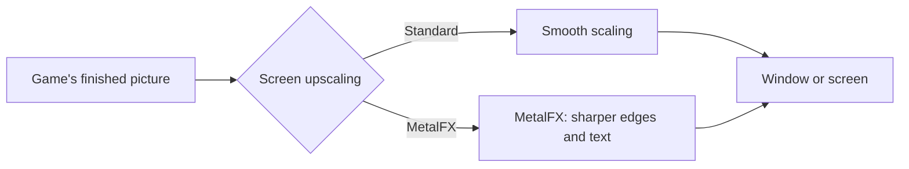
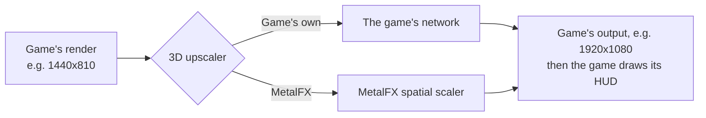
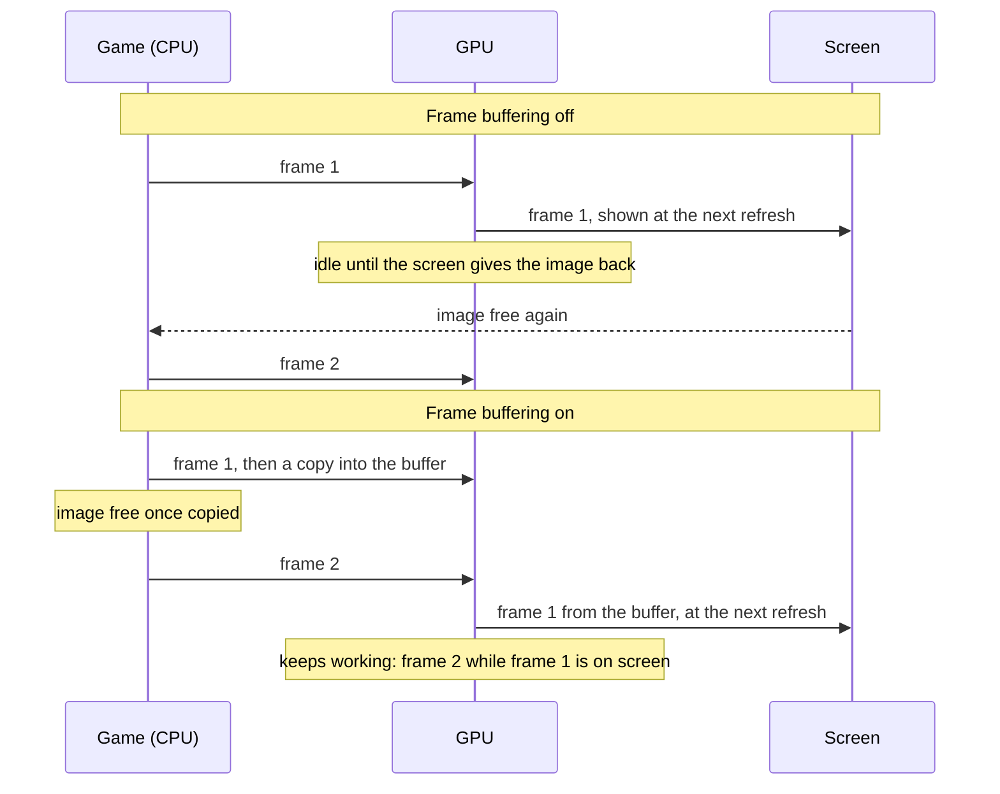
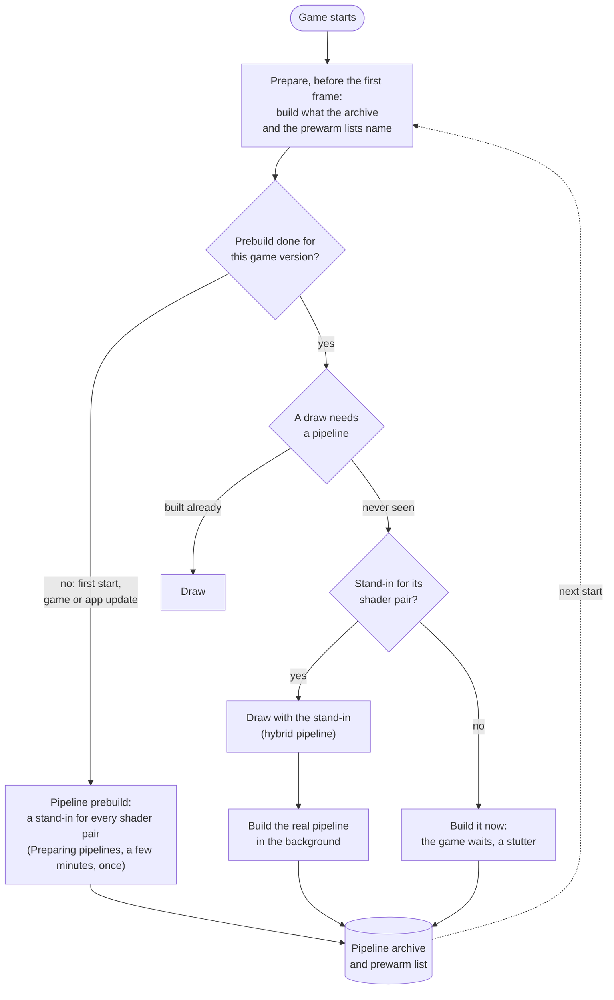
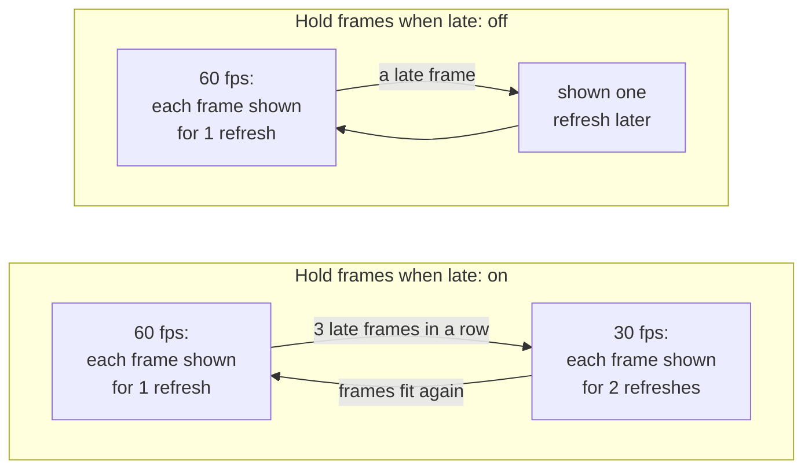

# Settings

The Mac app shows the game's settings in a [window](#the-mac-settings-window) before the game starts. A setting that only matters while another is on appears under it and disappears when that one is turned off. Click **Play** to start; the app remembers your choices for the next start. The settings are grouped under **Game**, **Controls** and **Performance**.

- [Tested defaults](#tested-defaults)
- [Game](#game): [Frame rate](#frame-rate), [Dynamic resolution](#dynamic-resolution), [Render scale](#render-scale), [Console mode](#console-mode), [Screen upscaling](#screen-upscaling), [3D upscaler](#3d-upscaler), [3D upscaler sharpness](#3d-upscaler-sharpness), [Game language](#game-language), [Display mode](#display-mode)
- [Controls](#controls): [Game rumble](#game-rumble), [Rumble strength](#rumble-strength), [Rumble cutoff](#rumble-cutoff), [Press a button to join](#press-a-button-to-join), [Switch 2 controllers](#switch-2-controllers), [Microphone](#microphone), [Microphone gain](#microphone-gain)
- [Performance](#performance): [Frame buffering](#frame-buffering), [Metal 4 pipelines](#metal-4-pipelines), [Pipeline prebuild](#pipeline-prebuild), [Encode thread](#encode-thread), [Hold frames when late](#hold-frames-when-late), [Performance HUD](#performance-hud), [Reset to tested defaults](#reset-to-tested-defaults)
- [The Mac settings window](#the-mac-settings-window)
- [Settings in a file](#settings-in-a-file)

## Tested defaults

The game comes with the settings it was tested with: its profile in this repository says, for example, that Ocarina of Time runs with the Encode thread on and a 3D upscaler sharpness of 70 %. Those are the defaults the settings window shows the first time.

When you change a setting and click **Play**, the app keeps your choice, also when a later build of the app ships other defaults. A setting you leave at its default is not stored: it follows the defaults of the build you have, so a newer build's tested settings reach you without doing anything. **Reset to tested defaults**, under Advanced settings, sets every setting back to its default, and **Play** then forgets your choices, so the game's defaults apply again. For testing, a line in the app's `env.txt` overrides any setting ([Settings in a file](#settings-in-a-file)).

The app carries the list as `Contents/Resources/dm/launcher.json`, for a front end that starts the app with the chosen values ([Front ends](frontends.md)).

## Game

### Frame rate

**30 fps** or **60 fps** (the default). 60 is smoother; 30 uses less power. The game runs at real speed either way.

### Dynamic resolution

Off, the default, keeps the 3D picture at full size. On lets the game lower its resolution when frames run heavy and raise it again when they fit: steadier frame rate, at times a softer picture. The game's note has the measurements ([Dynamic resolution](../dm/games/0400486024DEC000/README.md#dynamic-resolution)).

### Render scale

The size of the 3D picture, from 50 to 100 %, for a build whose rewritten code has a render scale stub. Ocarina of Time's has none, so its settings window does not show this setting; [Dynamic resolution](#dynamic-resolution) is its resolution control.

### Console mode

**Docked** (the default) renders at the console's TV resolution, **Handheld** at its lower handheld resolution, which is lighter on the GPU and can give a higher frame rate.

### Screen upscaling

A game that renders below the screen's resolution is scaled up to the screen. **Standard**, the default, scales smoothly; **MetalFX** uses Apple's MetalFX upscaler, which sharpens edges and text as it scales.

- **When to change it:** turn it on if the picture looks soft and the Mac has GPU time to spare. It helps in a large window or on a 4K screen.
- **Cost:** more GPU time each frame. Nothing changes while the game's picture is as large as its place on the screen. Unsupported sizes use Standard scaling.
- **Where:** under Advanced settings in the [settings window](#the-mac-settings-window), or `DM_PRESENT_UPSCALE=metalfx` in the app's `env.txt`.

### 3D upscaler

The game upscales its own 3D picture with a network of its own before the app sees it (agl's NDSR networks). **Game's own**, the default, keeps the game's upscaler. **MetalFX** replaces it with Apple's MetalFX spatial scaler: the same input and output sizes, at less GPU time, but Apple's scaler's picture rather than the game's.

- **When to change it:** when the game falls short of its frame rate in busy scenes because of GPU time. The game's note has the measurements ([Frame rate](../dm/games/0400486024DEC000/README.md#frame-rate)). Compare the look side by side before keeping it.
- **Cost:** none in GPU time; the picture is Apple's scaler's rather than the game's.
- **Not the same as [Screen upscaling](#screen-upscaling):** that one scales the finished picture, HUD included, to the screen; this one replaces the game's own step inside the frame. Both can be on.

### 3D upscaler sharpness

Shown under [3D upscaler](#3d-upscaler) while it is on **MetalFX**. MetalFX's spatial scaler gives a crisper picture than the network the game upscales with, and has no strength setting of its own, so the app blends its picture with a plain smooth one of the same input: 100 % is MetalFX's picture alone, lower values are softer. The starting value is the one tested against the game's own upscaler, 70 %.

- **When to change it:** by taste. Lower it when edges and fine textures look harsher than with the game's own upscaler, raise it when the picture looks soft.
- **Cost:** none measurable; it changes one draw the swap already makes.

### Game language

The game's own languages. The app was packed with one of them; pick another here without repacking. A NUP may come without the game's list of languages: every language is offered then, with a note, and a game that lacks the one you pick may show another.

### Display mode

**Window** (the default) or **Fullscreen**: how the game's window opens. ⌃⌘F or the green button changes it while you play. In an `env.txt`: `DM_FULLSCREEN=1` or `0`.

## Controls

### Game rumble

The game's vibration on a connected controller. On by default.

### Rumble strength

How strong the game's vibration is, from 0 to 300 %. Shown while Game rumble is on.

### Rumble cutoff

A controller's vibration weaker than this stays off, and the rest is spread over the full range. Off (0 %) by default. A controller with rotating motors can rumble all the time in a game that sends a quiet texture: Mario Kart 8 Deluxe needed about 45 % to rumble only on crashes and drifts.

### Press a button to join

Off by default: each controller is a player as soon as it connects, in the order the system lists them. On: a controller becomes a player only when you press one of its buttons, as the lowest player free, so the players choose their order and how many play. That press also reaches the game. When a game asks for more players than have joined, a prompt over the game waits for the others to press a button; B closes it.

### Switch 2 controllers

**Off** by default. On, the game takes Joy-Con 2 and Pro Controller 2 over Bluetooth: hold the small Sync button on one during the game, until its player lights sweep, to pair it with this Mac; after that a press of any of its buttons connects it ([Switch 2 controllers](playing.md#switch-2-controllers)). macOS asks for Bluetooth access the first time, and again after the app is packed again. In an `env.txt`: `DM_SW2=1`.

### Microphone

Shown when the game's code can take microphone input. Off by default. Turn it on and click Play to grant macOS access. The first enabled launch can ask even if the settings window is hidden. Choose an input device while the switch is on.

### Microphone gain

Shown under Advanced settings while Microphone is on: from 100 to 800 %, 400 % by default.

## Performance

These settings change how the app hands frames to the screen and how it prepares the GPU's work. The game's tested defaults are a good start; change them when the game stutters or you want less latency.

### Frame buffering

Each finished frame is copied into a buffer of two images that the screen shows from, so the game can start its next frame at once instead of waiting for the screen to give its image back. Off by default for Ocarina of Time.

- **Cost:** up to one frame more latency between your input and the screen, and two more frame-sized images in memory.

### Metal 4 pipelines

Before the GPU can draw something, the app has to build a *pipeline* for it: the game's shaders compiled for the Mac's GPU, with the drawing settings. Building one takes tens of milliseconds, so a scene full of new ones stutters. With Metal 4 pipelines, on by default, the app keeps what it built in a pipeline archive on the Mac, and builds most pipelines in a few microseconds from a shared base.

At start, before the game's first frame, the app prepares what it already knows: the pipelines in the archive and those the prewarm lists name (one comes with the game, one grows on the Mac as you play). A pipeline never seen before is drawn meanwhile with a stand-in for its pair of shaders, a *hybrid* pipeline that reads the draw's vertices in a general way and draws the same picture, while the real pipeline is built in the background and archived for the next start.

- **When to change it:** turn it off only if the game crashes or runs out of memory with it.
- **Cost:** memory for the archive while the game runs, and storage on the Mac.

### Pipeline prebuild

Builds a stand-in for every pair of shaders the game has and puts them into the pipeline archive, so that a scene you have never seen has a stand-in for each of its draws instead of a stutter. It runs before the game's first frame, behind a **Preparing pipelines** screen: the first start waits a few minutes for it, once, and so does the first start after a game update or an app update that brings new shaders. Every other start skips it. An app packed with its pipeline archive (the packing script's default) brings the stand-ins with it, so its first start builds none. It needs Metal 4 pipelines, and its row shows only while that option is on. On by default.

- **When to change it:** turn it off if you don't want to wait at that first start.
- **Cost:** on, a wait of a few minutes once. Off, no wait, but a pipeline seen for the first time makes the game stall briefly while it is built, until the archive holds it.

### Encode thread

The app turns the game's graphics commands into Metal commands on a thread of its own instead of the game's submitting thread, so the game's thread can go on sooner. On by default for Ocarina of Time: its profile sets it, with the measurement ([game.tsv](../dm/games/0400486024DEC000/game.tsv), `enc_thread`).

- **When to change it:** leave it on unless the game misbehaves with it; turning it off is a diagnostic step.

### Hold frames when late

With 60 fps chosen ([Frame rate](#frame-rate)), each frame is meant to stay on screen for one refresh. When a frame comes late, the app can either slow the game down to 30 fps for a while, or keep 60 and show late frames as they come.

- **On** (the default): an even 30 fps (or 20) in heavy scenes instead of a mix of 30 and 60.
- **Off:** the game keeps aiming at 60; a late frame is shown one refresh later and the next one goes on as usual, so heavy scenes look less even but stay closer to 60 on average.
- **When to change it:** turn it off if the game often falls to 30 fps although it is only slightly late.

### Performance HUD

Apple's performance overlay shows frame rate, frame and GPU times, and memory. It helps compare settings. Leave it off for play.

### Reset to tested defaults

Sets every setting back to the game's tested default; **Play** then forgets your choices, so those defaults apply, and those of later builds too ([Tested defaults](#tested-defaults)). Settings fixed by an `env.txt` or by the program that started the app stay as they are.

## The Mac settings window

The Mac app ([A Mac app](development.md#a-mac-app)) shows its settings in a window before the game starts. The window shows the most used ones first: **Frame rate**, **Console mode**, **Game language**, **Display mode**, **Game rumble** and **Microphone**. The others are under **Advanced settings**, in the usual sections, with **Reset to tested defaults**. The window remembers whether Advanced settings is open.

Click **Play** (or press Return) to start the game. **Quit**, ⌘Q or closing the window ends the app without the game. The app remembers your choices, and a game started without the window, from a front end or with the window turned off, uses them too ([Saved choices](frontends.md#saved-choices)). A setting fixed by an `env.txt` or by the program that started the app is shown greyed out.

Turn off **Show this window at launch** to start the game at once with your choices. Hold Option while the app opens to see the window again. `DM_LAUNCHER=0` in the app's `env.txt` or in its environment, or opening it with `open <app> --args --no-launcher`, also skips the window; your choices still apply. `DM_SAVED_CHOICES=0` starts with the tested defaults instead.

## Settings in a file

A line like `DM_PRESENT_SNAP=1` in the app's `env.txt` (`~/Library/Application Support/nxnative/<title ID>/env.txt`) sets a setting from the file: the settings window shows it greyed out, and the file wins over your choice and the game's default. Quit and reopen the app after editing the file. The variables:

| Setting | Variable | Values |
|---|---|---|
| Frame rate | `DM_FPS_TARGET` | `30`, `60` |
| Dynamic resolution | `DM_DYNAMIC_RESOLUTION` | `1`, `0` |
| Render scale | `DM_RENDER_SCALE` | `0.5` to `1.0` (a build with a render scale stub) |
| Console mode | `DM_OPMODE` | `1` docked, `0` handheld |
| Screen upscaling | `DM_PRESENT_UPSCALE` | `off`, `metalfx` |
| 3D upscaler | `DM_UPSCALER` | `game`, `metalfx` |
| 3D upscaler sharpness | `DM_UPSCALER_SHARPNESS` | `0.0` to `1.0` |
| Game language | `DM_LANG` | a language code, such as `ja` |
| Display mode | `DM_FULLSCREEN` | `1` fullscreen, `0` a window |
| Game rumble | `DM_RUMBLE` | `1`, `0` |
| Rumble strength | `DM_RUMBLE_GAIN` | `0` to `3` |
| Rumble cutoff | `DM_RUMBLE_MIN` | `0` to `0.9` |
| Press a button to join | `DM_PAD_PRESS_TO_JOIN` | `1`, `0` |
| Switch 2 controllers | `DM_SW2` | `1`, `0` |
| Microphone | `DM_MIC` | `1`, `0` |
| Microphone gain | `DM_MIC_GAIN` | `1` to `8` |
| Frame buffering | `DM_PRESENT_SNAP` | `1`, `0` |
| Metal 4 pipelines | `DM_PSO_MTL4` | `1`, `0` |
| Pipeline prebuild | `DM_PSO_PREBUILD` | `1`, `0` |
| Encode thread | `DM_NVN_ENC_THREAD` | `1`, `0` |
| Hold frames when late | `DM_FPS_HOLD` | `on`, `off` |
| Performance HUD | `DM_METAL_HUD` | `1`, `0` |

`DM_LAUNCHER=0` skips the settings window; the choices you saved there still apply. `DM_SAVED_CHOICES=0` starts with the tested defaults and keeps your saved choices for later. How the settings are listed for the game: [dm/games/settings.tsv](../dm/games/settings.tsv).
